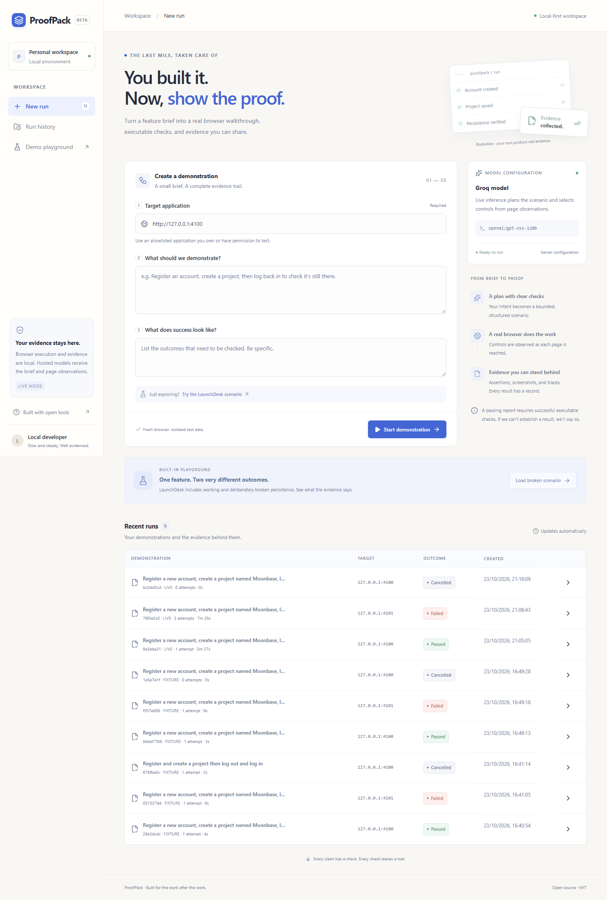
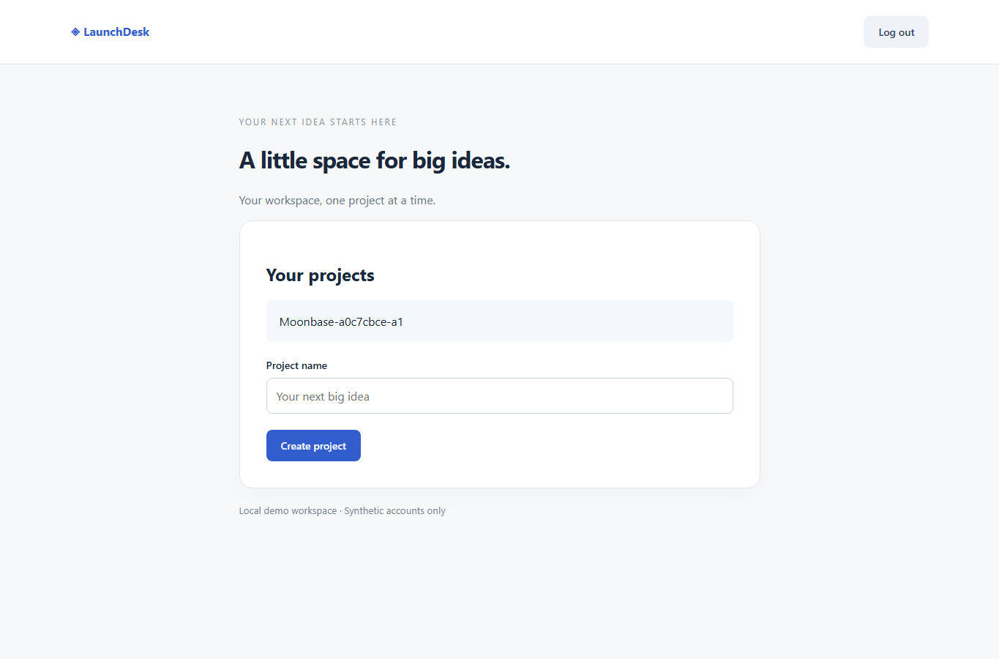
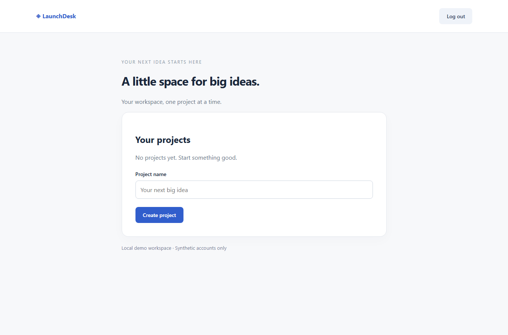
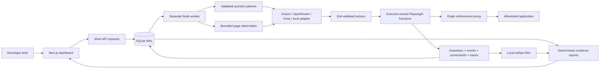

# ProofPack

**You built the feature. Let ProofPack demonstrate it and collect the evidence.**

ProofPack turns a short feature brief into a bounded browser demonstration with executable assertions, screenshots, an event timeline, and downloadable evidence. Built for Hacktoberfest Week 3, **Slow and Steady**: small explicit checks, durable progress, and results you can inspect.

It is a local-first TypeScript application, with a Next.js dashboard, a separate browser worker, SQLite storage, and replaceable open-model adapters. A report passes only when its required assertions pass. An unavailable target is **Blocked**, not a failed feature.



## Start locally

Requires Node.js **22.16 or later** and npm. SQLite uses `better-sqlite3`; supported Node versions normally have prebuilt binaries. If your platform requires compilation, install its native build tools.

```sh
npm ci
npm run browsers
```

Copy `.env.example` to `.env` (PowerShell: `Copy-Item .env.example .env`; macOS/Linux: `cp .env.example .env`). Defaults work without a key in explicitly labeled fixture mode.

```sh
npm run dev:all
```

Open **http://127.0.0.1:3000**. This starts four separate processes:

| Process            | Command                | Address                      |
| ------------------ | ---------------------- | ---------------------------- |
| Dashboard + API    | `npm run dev`          | http://127.0.0.1:3000        |
| Browser worker     | `npm run worker`       | Polls SQLite; no HTTP server |
| Working LaunchDesk | `npm run demo:working` | http://127.0.0.1:4100        |
| Broken LaunchDesk  | `npm run demo:broken`  | http://127.0.0.1:4101        |

On Windows, use `npm.cmd` / `npx.cmd` if PowerShell blocks `.ps1` scripts. Stop the combined command with Ctrl+C. All servers bind to loopback. Do not expose them publicly.

For production execution, run `npm run build` then `npm run start:all`. You can also run `npm start`, `npm run worker`, and the two demo commands in separate terminals. The worker remains a separate Node.js process.

## Demonstrate both outcomes

1. Choose **Try the LaunchDesk scenario** and **Start demonstration**. On port 4100, registration, project creation, logout, a new browser context, and login produce four passing assertions.
2. Open the evidence report. Inspect the project screenshot after the fresh login, then export Markdown or self-contained HTML. Download the separate Playwright traces.
3. Return home and choose **Load broken scenario**. Port 4101 runs the same browser procedure; the final project-persistence assertion fails because the project is missing after login.

Each run uses an account such as `proof-<run-prefix>-a1@example.test` and a project such as `Moonbase-<run-prefix>-a1`. Retries use `a2`, with new credentials and evidence. Fixture names are intentionally fixed; live planning uses the supplied feature brief and expected outcomes.

These are screenshots from **actual Chromium executions**, not fabricated sample data:

| Working: project remains after fresh login                                          | Broken: project disappears after fresh login                                      |
| ----------------------------------------------------------------------------------- | --------------------------------------------------------------------------------- |
|  |  |

No rows are seeded into history at installation. New rows represent real runs. For real pre-generated fixture demonstrations, start only the two LaunchDesk processes, leave the worker stopped with an empty queue, and run `npm run demo:seed`. That command executes Chromium; it does not insert fake outcomes. Alternatively, `npm run test:dashboard` creates actual runs through the running dashboard and worker.

See [the three-minute demo script](docs/demo-script.md).

## Architecture



| Directory           | Responsibility                                                                                                |
| ------------------- | ------------------------------------------------------------------------------------------------------------- |
| `src/app`, `src/ui` | Next.js routes, responsive dashboard, polling, history and report view                                        |
| `src/db`            | Drizzle typed run/attempt tables, parameterized SQLite repositories and transactional claims                  |
| `src/core`          | Configuration, Zod contracts, deterministic outcome rules                                                     |
| `src/worker`        | Queue polling and process lifecycle                                                                           |
| `src/ai`            | Structured planning and observation-grounded action decisions; separate fixture recipe                        |
| `src/execution`     | Playwright observations, accessible control resolution, bounded actions, proxy, evidence and trace sanitation |
| `src/reports`       | Deterministic Markdown and self-contained HTML exports                                                        |
| `src/launchdesk`    | Separate demo HTTP application; no fixture internals are imported by the executor                             |
| `scripts`, `tests`  | Real browser verification, adapter/queue/report tests and model discovery                                     |

The API only validates and queues runs. The worker uses `BEGIN IMMEDIATE` to claim one job atomically and renews its lease roughly every third of the lease duration. SQLite uses WAL, foreign keys, and a five-second busy timeout to handle dashboard/worker writes. Independent workers may share one local database. The MVP does not use Redis or Temporal.

An expired lease marks the attempt **Interrupted**. Open browsers and in-memory state are never claimed to survive a crash. A user can retry failed, blocked, or interrupted runs up to `MAX_ATTEMPTS`; the earlier attempt stays visible. State-changing actions are never blindly retried after an ambiguous execution error. Model repairs are bounded to three attempts per response, plus overall limits on calls, actions, and time.

The planner defines named goals, input variables, success criteria, and assertion specifications. Each required assertion belongs to exactly one goal. The browser observes new pages as reached, and the decision adapter selects only actions and control IDs available in that bounded observation. Password values never enter the observation or model prompt. Accessible labels and roles are preferred, with test IDs as a fallback. The model cannot supply selectors, JavaScript, shell commands, or Playwright code.

The durable ledger determines the result. Both finalization and report generation check the ledger before accepting a pass. Narrative generation is deterministic in this MVP, so a summarizing model cannot rewrite outcomes or invent evidence IDs.

See [architecture, failure modes, and engineering notes](docs/architecture.md).

## Open models

**Fixture mode** is the default and supports the documented LaunchDesk persistence scenario only. It uses deterministic planning and decisions but a real Chromium browser and real assertions. The dashboard, timeline, call metadata, and exports label it clearly. There is **no automatic fallback** from live to fixture mode.

For OpenRouter:

```dotenv
MODEL_MODE=live
MODEL_PROVIDER=openrouter
MODEL_BASE_URL=https://openrouter.ai/api/v1
MODEL_ID=google/gemma-3-27b-it
MODEL_API_KEY=your-key-here
MODEL_FORMAT=auto
```

Gemma 3 27B is an open-weight instruction model. Its identifier and `structured_outputs` support were confirmed from the provider's actual model catalog on **2026-10-23**. Availability does not establish that your account can run inference. Check the current catalog:

```sh
npm run model:check
```

The live adapter probes the catalog in auto mode, requests a JSON schema when supported, and validates every response with Zod regardless of provider enforcement. Unsupported structured format combinations fail visibly. Missing/invalid output gets bounded repair opportunities. Actual provider, returned model ID, latency, and available usage are recorded per call; missing tokens and cost remain unavailable.

For **Groq**, use the settings in [.env.groq.example](.env.groq.example):

```dotenv
MODEL_MODE=live
MODEL_PROVIDER=groq
MODEL_BASE_URL=https://api.groq.com/openai/v1
MODEL_ID=openai/gpt-oss-120b
MODEL_API_KEY=your-groq-key-here
MODEL_FORMAT=auto
```

Put the real key only in the ignored `.env` file. The recorded live verification uses GPT-OSS 120B with strict structured-output support. The adapter checks the account's model catalog, uses the documented schema subset while preserving full Zod validation, and reserves output tokens for reasoning. It honors HTTP 429 `Retry-After` within the three-attempt and total runtime budgets; an indicated delay over 60 seconds stops clearly. Authentication/configuration HTTP errors stop without repeated identical requests. Hosted page observations leave the machine for Groq just as they do for OpenRouter.

After saving a key, run `npm run model:check`, then `npm run test:live`. Restart both dashboard and worker to use the new configuration. [Groq models](https://console.groq.com/docs/models) · [structured outputs](https://console.groq.com/docs/structured-outputs) · [rate limits](https://console.groq.com/docs/rate-limits)

For a local OpenAI-compatible model server, load an instruction-tuned open model and configure its actual ID:

```dotenv
MODEL_MODE=live
MODEL_PROVIDER=local
MODEL_BASE_URL=http://127.0.0.1:1234/v1
MODEL_ID=your-loaded-model-id
MODEL_API_KEY=
MODEL_FORMAT=json_schema
```

Use `json_object` or `none` if your local server does not support JSON schema requests. For local endpoints, `auto` uses plain JSON prompting and application validation; capabilities are not guessed. Restart **both dashboard and worker** after editing model settings. A worker refuses jobs queued under a different provider/mode/model.

Open models let developers choose a provider, move inference to their own hardware, and inspect or adapt model behavior. They do not remove the need for application validation or executable checks. Gemma and other models have their own licenses; the MIT license here applies to original project code, not model weights.

**Live Groq inference verified:** the working LaunchDesk passed all four persistence checks, the broken instance failed only the final persistence check, and live cancellation, unavailable-target, injected-invalid-output, prompt-injection/origin and report/trace checks completed. See [the live verification record](docs/live-verification.md), including preserved earlier failures and provider rate limits. Actual inference through OpenRouter and local endpoints remains unverified; their protocol tests use mocked responses. Fixture evidence is labeled separately.

Primary API references: [Next.js route handlers](https://nextjs.org/docs/app/getting-started/route-handlers), [Playwright network routing](https://playwright.dev/docs/network), [OpenRouter structured outputs](https://openrouter.ai/docs/guides/features/structured-outputs), [OpenRouter model catalog](https://openrouter.ai/api/v1/models), [Zod JSON schema](https://zod.dev/json-schema).

## LaunchDesk persistence

LaunchDesk uses independent SQLite databases (`data/launchdesk-4100.sqlite` and `data/launchdesk-4101.sqlite`), salted scrypt password hashes, expiring opaque server sessions, HttpOnly SameSite cookies, and authenticated user-scoped project queries. No real email is sent. Use synthetic accounts only.

The deliberate broken instance writes projects with the creating session token. It shows them during that session but a new login gets another token, so those projects disappear from the project list. The mode is fixed per server instance, avoiding shared toggles. ProofPack does not read that database or configuration; it reports only the observed absence after login. It does not claim a confirmed underlying root cause.

## Data and execution boundaries

- Only exact origins in `ALLOWED_TARGET_ORIGINS` are permitted. Defaults allow the two explicit local demo ports, not arbitrary localhost services. The API checks the initial target; the executor checks navigations and uses both browser request interception and an origin-enforcing HTTP/CONNECT proxy that also gates redirect hops. Popups and WebSockets are unsupported and blocked; service workers are disabled. Unsupported schemes and common metadata destinations are rejected.
- The proxy is necessary: Playwright request routes alone can miss redirected requests. A browser integration check proves a disallowed local sink receives zero requests from ordinary requests, popups, WebSockets, and a redirect.
- Secrets stay in server configuration, never `NEXT_PUBLIC_*`. Synthetic passwords are substituted only by the executor, masked in screenshots, removed from stored actions/errors, and redacted from finalized traces. Trace DOM snapshots and trace screenshots are disabled. Cookie and authorization fields are sanitized before a trace is downloadable. The separate screenshots remain the visual evidence.
- Hosted inference receives the feature brief, expected outcomes, bounded visible page text, control labels, URL paths, and previous structured actions with placeholders. Generated password values are never sent. Provider retention policies still apply. Screenshots and traces are not sent to the model. With a local model endpoint, those model requests stay at that configured endpoint; the browser still accesses the allowlisted target. The dashboard itself does not require a cloud service in fixture mode.
- Target text is treated as untrusted. Instructions from a page cannot expand the action vocabulary or allowed origins. This local MVP is **not a hardened sandbox for hostile websites**. Use applications you control; keep sensitive information out of target pages and briefs. Captured target text and screenshots can contain application data. Review evidence before sharing it.
- The dashboard uses loopback binding and rejects nonlocal hosts and cross-origin writes. It has no multiuser authentication and must not be placed on a public interface or untrusted reverse proxy.

## Checks

```sh
npm run typecheck
npm run lint
npm test
npm run test:e2e
npm run build
```

`test:e2e` starts its own demo servers on **4200–4204**, uses an isolated verification database/artifact directory, and closes the servers. It verifies working persistence, broken persistence, unreachable targets, invalid model output, cancellation, expired leases with a fresh retry, origin boundaries, embedded HTML evidence, and finalized traces.

With `npm run dev:all` running, execute:

```sh
npm run test:dashboard
```

This creates real working, failing, and cancelled runs through the local API/UI; checks exports, evidence downloads, history, forbidden requests, browser errors, and mobile layout; and captures screenshots. It is not a placeholder data generator. Use `npm run format` to format source.

With live mode and credentials configured, `npm run test:live` starts isolated demos on **4300–4304** and makes real model requests. It checks working and broken persistence coverage, unreachable targets, cancellation after a live decision, bounded rejection of intentionally corrupted live responses, prompt injection/origin boundaries, exports, trace sanitation, and actual usage metadata. Injected corruption is explicitly labeled and is not presented as a natural model failure. This command consumes provider quota; errors and rate limits remain visible. Results are written only after execution to `docs/live-verification-results.json`, with HTML/Markdown artifacts under `data/live-verification/`.

`test:dashboard` also supports live mode and checks actual persistence coverage rather than assuming fixture assertion IDs. Live screenshots/results use a `live-` filename prefix to preserve the recorded fixture evidence.

[Actual verification record](docs/verification.md) · [machine-readable browser results](docs/verification-results.json) · [manual baseline worksheet](docs/manual-baseline.md)

## Limits

The MVP handles accessible forms and navigation, exact visible-text/URL assertions, and a fixed set of synthetic input placeholders. CAPTCHA, MFA, file upload, arbitrary scripting, popup workflows, WebSockets, visual comparisons, and arbitrary custom input variable types are outside scope. Local/hosted model quality can affect control resolution; live runs may block. Exact origin allowlists may require explicitly adding a controlled static/API origin for your application. Do not add broad third-party origins casually.

Polling is intentionally simple. Large HTML exports embed all screenshots and consume memory; there is no artifact retention scheduler. Run history lists the most recent 100 runs. There is no automatic retry of state-changing actions. HTTPS proxy tunnels are implemented but the recorded browser suite uses local HTTP targets. Crash detection was verified through explicit lease expiry; an OS-level power-loss test was not performed.

## License

[MIT](LICENSE) for original ProofPack source. Dependency licenses and model licenses remain separate. Nothing has been deployed publicly or submitted to the challenge.
