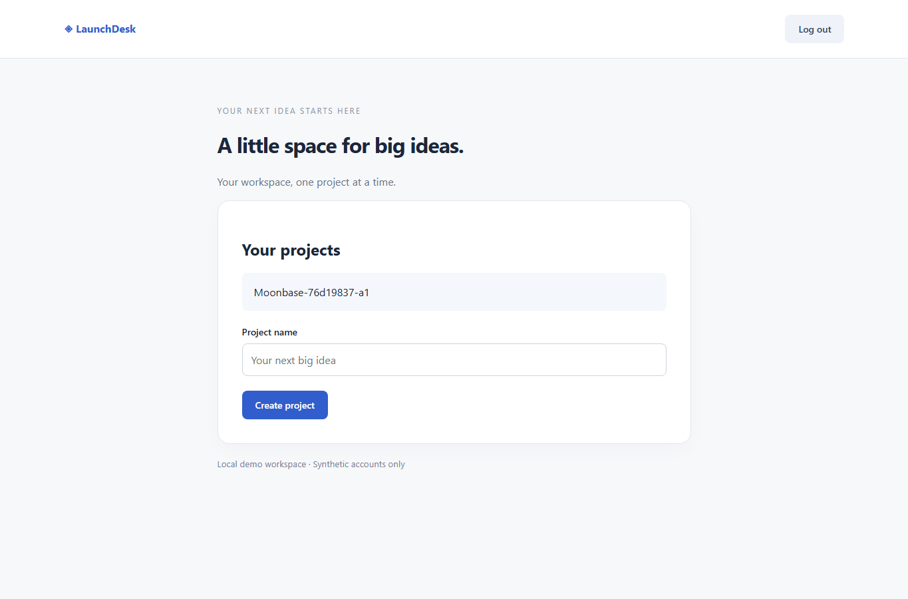

# Live Groq verification

Actual hosted inference and real Chromium execution were verified on 23 October 2026 using **Groq / `openai/gpt-oss-120b`**, strict JSON-schema output, and the key stored in the ignored local `.env`. No fixture fallback was used. The catalog check established account access; the runs below established inference and browser behavior.

## Recorded outcomes

[Machine-readable results](live-verification-results.json) contain exact timestamps, run IDs, provider/model identity, and explicit reuse of previously verified evidence. The local SQLite database and exported HTML/Markdown are under the recorded `data/live-verification/` directory; local data and credentials are excluded from Git.

| Check                            | Actual outcome                                                                                                                                                                                                                              |
| -------------------------------- | ------------------------------------------------------------------------------------------------------------------------------------------------------------------------------------------------------------------------------------------- |
| Working LaunchDesk               | **Passed, 4/4** assertions: project creation, logout URL, login URL, project present after a fresh browser context and login. Run `76d19837-8358-4d7c-a7cc-14d5147475bd`.                                                                   |
| Broken LaunchDesk                | **Failed, 3/4** assertions: final project text absent after fresh login. Run `e42adbfb-0dba-4f33-9567-63f46b31b883`. This is the expected detection of the deliberate bug.                                                                  |
| Unreachable target               | **Blocked**, after a real valid live plan; no assertions claimed.                                                                                                                                                                           |
| Cancellation                     | **Cancelled** after the second real live decision. Browser step count did not increase after the explicit cancellation boundary.                                                                                                            |
| Invalid output fault injection   | **Blocked** within three attempts: two actual live responses intentionally replaced with unsupported actions, plus one HTTP 429 transport failure. No browser steps executed. This does not claim Groq naturally produced malformed output. |
| Untrusted page / origin boundary | **Passed** the requested heading assertion; **zero** requests reached the forbidden sink despite image, fetch, popup and WebSocket attempts. Run `1b423a20-6821-486a-b0ba-4a7f1f1258aa`.                                                    |
| Reports and traces               | Embedded screenshots, ledger-matching Markdown, live provider metadata and traces from both browser contexts verified. API key and session-token patterns absent from inspected reports/records/traces.                                     |

The verification independently requires creation, logout, a fresh context, login, and persistence coverage. A heading-only or URL-only plan cannot masquerade as a successful persistence demonstration. The executor never reads LaunchDesk's database to decide outcomes.

| Working: final assertion after fresh login                                            | Broken: final assertion after fresh login                                           |
| ------------------------------------------------------------------------------------- | ----------------------------------------------------------------------------------- |
|  |  |

[Actual model metadata](live-run-metadata.json) records call counts, returned token usage, elapsed time and trace counts from the saved ledger. The isolated working run took 227.1 seconds and recorded 20 valid responses plus 20 rate-limited attempts. The broken run took 227.3 seconds and recorded 20 valid responses plus 21 rate-limited attempts. Failed requests with unavailable usage are not assigned invented token counts or costs.

An additional real Chromium check opened both saved HTML exports through local file URLs, without the dashboard: all **10** working-report images and **12** broken-report images loaded from embedded PNG data. [Export verification](live-export-verification.json) records these counts.

## Commands actually used

```powershell
npm.cmd run model:check
npm.cmd run test:live
# Resume recorded evidence after an unrelated harness failure:
npm.cmd run test:live -- --resume=data/live-verification/0b219a2d-7f58-4504-abf3-90a7710e618c
npm.cmd run build
npm.cmd run start:all
npm.cmd run test:dashboard
```

Resume revalidates saved persistence evidence instead of making duplicate inference requests. The network-sink test always executes again so a newly empty sink counter cannot stand in for a prior boundary result. A cancelled run cannot be selected as the saved successful persistence run. The summary records reused run IDs.

The first resume implementation selected a previously cancelled run sharing the same request, and its status assertion stopped immediately. Filtering by the required outcome corrected this harness bug. `live-verification-resume-initial-results.json` preserves that stopped resume; it did not make a new browser demonstration or alter the cancelled record.

## What the live runs uncovered

The production Next.js dashboard and separate worker also completed live verification. [Dashboard results](live-dashboard-verification.json) record **nine successful checks**, including report/trace downloads, cancellation, forbidden-target and cross-origin rejection, persisted history, a 390px viewport without horizontal page overflow, and no browser page errors.

The working run (`6e3eba31-41b8-4b3a-9293-c0b9d151a80d`) passed 4/4. The broken run (`7f95e3c0-ef72-4eab-aa90-0bb2298cf1a7`) first stopped after three HTTP 429 responses, before the final checks. That original **Blocked** attempt is preserved in [the initial record](live-dashboard-initial-results.json). Clicking **Retry in fresh attempt** through the actual UI created attempt 2 with `a2` test data; it completed **Failed, 3/4**, with the final project absent. The recovery command revalidated the saved passing run instead of consuming more quota to repeat it:

```powershell
npm.cmd run test:dashboard -- --resume-pass=6e3eba31-41b8-4b3a-9293-c0b9d151a80d --retry-run=7f95e3c0-ef72-4eab-aa90-0bb2298cf1a7
```

Actual screenshots: [dashboard](screenshots/live-dashboard.png), [mobile](screenshots/live-mobile.png), [passing report](screenshots/live-evidence-report.png), and [failed report](screenshots/live-failed-report.png). The failed report visibly preserves the first attempt's blocked reason; [its verification](live-failed-report-verification.json) records the final 3/4 ledger and both outcomes.

Early 20B runs invented a success message or repeated registration/navigation. They were failed or explicitly cancelled, with summaries retained in `live-verification-initial-results.json`, `live-verification-planner-loop-results.json`, and `live-verification-form-state-results.json`. An early 120B attempt also looped and hit provider limits; see `live-verification-rate-limit-results.json`. These attempts are not relabeled as successful.

The main context bug was that past actions referenced control IDs from old observations. The model interpreted those IDs against the current page and repeated work. Decisions now receive executed actions with before/after URLs and explicit provenance, the current goal and its assigned assertions. Observations expose only whether a field is filled, whether it is required, and its form membership. They never expose its value. Guards reject unchanged repeated actions, repeated context resets and submitting the same form with empty required inputs.

A simple heading request then exposed an overly broad planner instruction: it added the account workflow to an unrelated task. The planner now scopes persistence guidance to requested persistence tasks, and input-free plans can have zero variables. The corrected live heading run passed. The original blocked run remains in the local database (`830d717a-2e52-4df9-9ae5-8c9b6dcbb64d`); it ended on HTTP 400, whose body was omitted. Its summary is preserved in `live-verification-boundary-initial-results.json`.

Groq returned real HTTP 429 responses during these runs. Retry-After waits remain bounded by three request attempts, total model calls and the run deadline. Transport errors share the validation budget. The harness initially assumed all three fault-injection attempts would reach response validation; it was corrected to account for mixed transport/validation failures. A rate-limit event and dashboard countdown make waits visible. Delays over 60 seconds stop clearly instead of waiting indefinitely.

The selected 120B configuration completed the recorded scenarios. This small verification is not a reliability benchmark or a guarantee for arbitrary applications. OpenRouter and local endpoints remain protocol-supported but their actual inference was not verified here. Costs were not calculated; only usage returned by the provider is recorded.

## Scope

The isolated suite uses controlled HTTP targets on ports 4300–4304. Fixture regression additionally covers redirects and lease expiry. HTTPS CONNECT support exists but HTTPS target execution was not verified. No OS power-loss test, public deployment, publication or challenge submission was performed. Hosted inference receives bounded page observations and the request; screenshots and traces remain local. Do not display `.env` while recording a demo.
